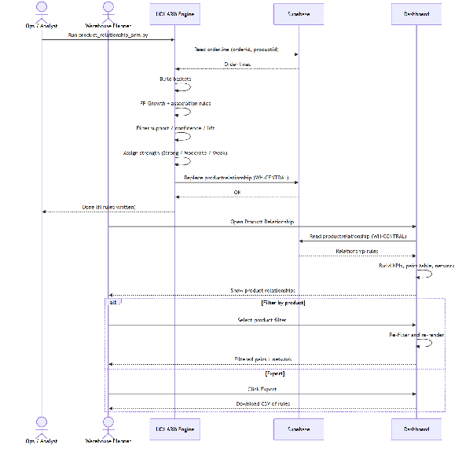
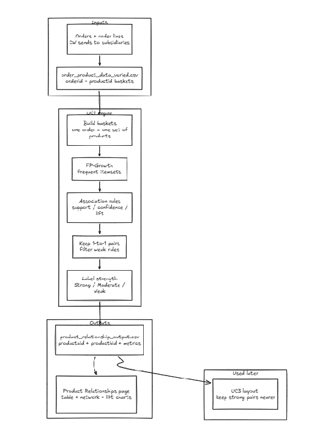
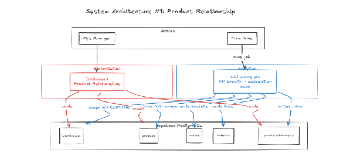
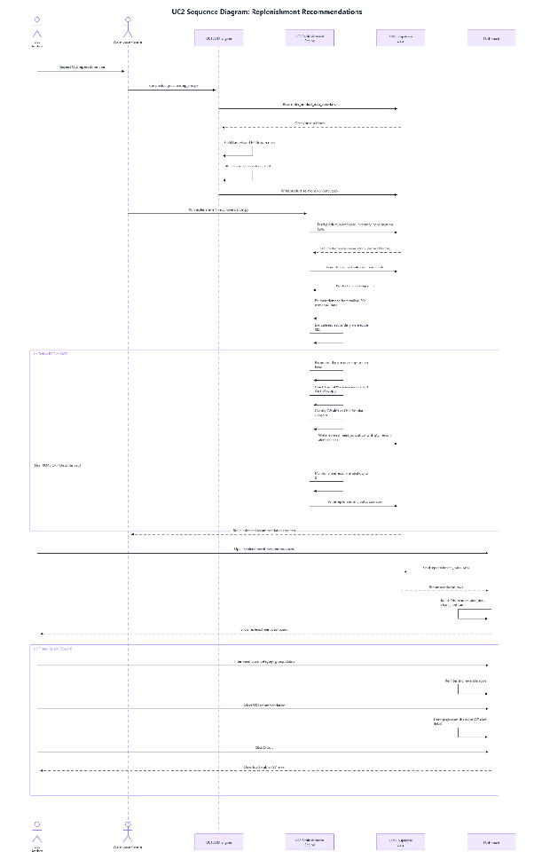
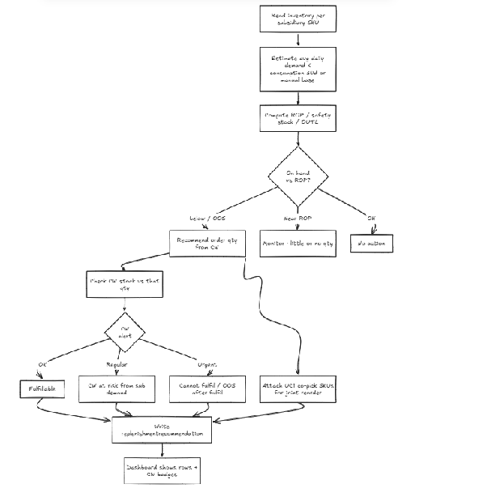
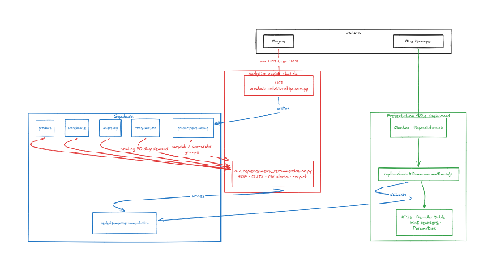
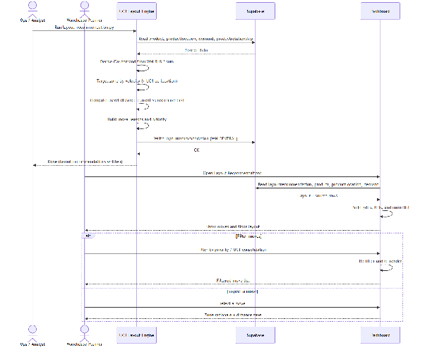
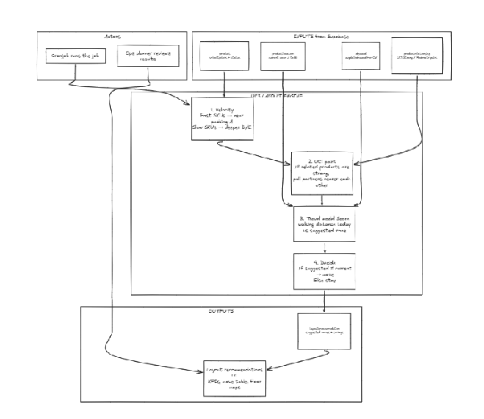
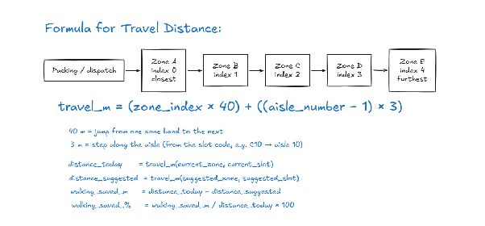
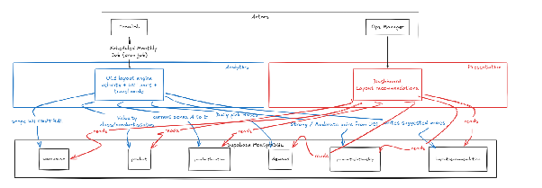

# MedFlow System Architecture Workflow

| Field | Value |
| --- | --- |
| Document | System architecture workflow |
| Last updated | 28 Aug 2026 |

MedFlow is a warehouse operations dashboard for DHL medical/healthcare supply logistics. It helps a planner see what products go together, what needs replenishing, and how to rearrange the central warehouse floor.

| Use Case | Question it Answers | Engine |
| --- | --- | --- |
| UC1 Product Relationship | Which SKUs are frequently ordered together on the same subsidiary order from central? | FP-Growth association rule mining |
| UC2 Replenishment | For each subsidiary SKU: is stock too low, how many units to transfer from central, can central fulfil, and which UC1 companions should travel together? | Deterministic (s,S) continuous-review policy |
| UC3 Layout | Where should each SKU sit on the central floor to minimise expected picker travel? | Layout heuristic, then simulated annealing |

UC1 must run before UC2 and UC3. Both later use cases read `productrelationship` (Strong / Moderate pairs for co-pick and affinity). Write order: `modelrun` → UC1 → UC2 → UC3.

## Use Case 1: Product Relationship

| | |
| --- | --- |
| **Description** | UC1 finds which medical SKUs are frequently ordered together on the same subsidiary order from the central warehouse, so planners can use those pairs for replenishment co-pick and layout affinity. |
| **Purpose** | From historical `orderline` baskets, the system discovers association rules (support, confidence, lift) and bands them Strong / Moderate / Weak. |
| **How it Works** | Ops/Analyst runs `engines/uc1/arm.py`. Engine reads `orderline` (`orderid`, `productid`) from Supabase, builds one basket per `orderid`, runs FP-Growth (`mlxtend`, min_support 0.02), then keeps 1→1 rules that pass the baseline filter: support ≥ 0.03, confidence ≥ 0.40, lift ≥ 1.20. Rules are banded and written to `productrelationship` (tagged for the central warehouse). |
| **What planner sees** | Product Relationship page: KPIs (unique products, pairs, strong relationships, avg lift), combinations table, network graph, product filter, export. |

### Sequential diagram

*Figure 1. UC1 Product Relationship sequence.*

### Workflow 1: Product Relationship

*Figure 2. UC1 Product Relationship workflow.*

**Inputs**

- `orders` / `orderline` (central → subsidiaries)
- Built into baskets: one `orderid` → set of `productid`s

**UC1 engine** (`engines/uc1/arm.py`)

1. Data extraction: scan `orderline` (`orderid`, `productid`)
2. Basket construction: one unique `orderid` → set of `productid`s
3. Frequent-pattern mining: FP-Growth, min_support = 0.02
4. Rule generation and baseline filter:
   - Support ≥ 0.03
   - Confidence ≥ 0.40
   - Lift ≥ 1.20
5. Banding, then write `productrelationship`

| Band | Support | Confidence | Lift |
| --- | --- | --- | --- |
| **Strong** | ≥ 0.08 | ≥ 0.55 | ≥ 1.50 |
| **Moderate** | ≥ 0.04 | ≥ 0.40 | ≥ 1.20 |
| **Weak** | Passes baseline | Passes baseline | Passes baseline |

**Outputs**

- `productrelationship` (consequent SKU + metrics; antecedents as child rows)
- Product Relationships page: table, network, lift charts

**Used later**

- UC2 attaches Strong / Moderate companions for possible joint replenishment (does not force them in)
- UC3 uses co-pick counts / support / lift as affinity so related SKUs sit nearer each other

### System architecture 1: Product Relationship

*Figure 3. UC1 Product Relationship system architecture.*

**Database — Supabase PostgreSQL**

| Table | Role in this diagram |
| --- | --- |
| warehouse | Scope (WH001 CENTRAL) |
| product | SKU names / product info |
| orders | Order baskets for mining |
| orderline | Line items inside baskets |
| modelrun | Run lineage (insert first) |
| productrelationship | Output: pair metrics, band, rulesource `FP-Growth` |
| productrelationshipantecedent | Antecedent SKUs as FKs |

## Use Case 2: Replenishment

| | |
| --- | --- |
| **Description** | UC2 recommends replenishment from central to each subsidiary SKU using a deterministic (s,S) policy. It flags OOS / Low Stock / Near ROP / Available, checks whether central can fulfil, and suggests UC1 co-pick items. |
| **Purpose** | An auditable reorder trigger: s = ROP (alarm), S = OUTL (ceiling). Preferred over black-box demand ML so warehouse managers can explain a medical stockout. |
| **How it Works** | Ops/Analyst runs `engines/uc2/replenishment.py`. Engine reads consumption (or estimates it), inventory, warehouse policy, and UC1 pairs from Supabase. It calculates ADD (default trailing 30 days), Safety Stock, ROP, EOQ and OUTL. When Inventory Position ≤ ROP, recommended qty = OUTL − Inventory Position (minimum 0). It then checks central available stock (full / partial / unavailable) and attaches Strong or Moderate UC1 companions without forcing them. Results are written to `replenishmentrecommendation`. |
| **What planner sees** | Replenishment page: status bands and fulfilment, recommended transfer qty, SKU detail (stock, ROP, safety stock, demand), joint-replenishment cards from UC1, filters, export. |

### Sequential diagram

*Figure 4. UC2 Replenishment sequence.*

### Workflow 2: Replenishment Recommendation

*Figure 5. UC2 Replenishment Recommendation workflow.*

**Actors**

- Batch / Ops planner runs `engines/uc2/replenishment.py`
- Warehouse planner reviews replenishment recommendations in the UI

**Inputs (Supabase)**

- product — SKU info, status (exclude Discontinued from positive reorders)
- warehouse — CENTRAL (WH001) and SUBSIDIARY (WH002)
- inventory — `qtyonhand` by SKU and warehouse
- consumption — demand history (or estimate from inventory movements)
- warehouseproduct / warehouseproductcalculation — current policy knobs
- productrelationship — UC1 Strong / Moderate pairs

**Engine steps** (from the technical doc)

1. **Consumption calculation:** actual subsidiary consumption, or estimate from previous / received / current inventory
2. **Demand estimation:** Average Daily Demand using `demandhistorydays` (default 30)
3. **Policy calculation:** Z-score, lead-time demand variability, Safety Stock, ROP (s), EOQ, OUTL (S)
4. **Threshold evaluation:** Inventory Position vs ROP
5. **Quantity:** if IP ≤ ROP, Recommended Quantity = OUTL − Inventory Position (≥ 0)
6. **Central-availability check:** full, partial, or unavailable
7. **UC1 synergy:** attach Strong or Moderate companions; do not force inclusion
8. Write `replenishmentrecommendation` + `modelrun` metadata

| Status | Rule | UI action |
| --- | --- | --- |
| **OOS** | On-hand ≤ 0 | Urgent: stockout. Immediate transfer |
| **Low Stock** | Inventory Position ≤ ROP | Regular: threshold breached; calculate recommended qty |
| **Near ROP** | Inventory Position ≤ ROP + safety stock | Monitor; recommended qty = 0 for now |
| **Available** | Above the Near ROP band | Healthy; no action |

**Outputs**

- `replenishmentrecommendation` — recommended qty, status, fulfilment, reason, optional `relationshipid`
- Replenishment UI: KPIs, reorder table, SKU detail, projection, joint-replenishment cards

### System architecture 2: Replenishment Recommendation

*Figure 6. UC2 Replenishment Recommendation system architecture.*

**Database — Supabase PostgreSQL**

| Table | Role in this diagram |
| --- | --- |
| warehouse | CENTRAL vs SUBSIDIARY |
| product | SKU names, status |
| inventory | On-hand (`qtyonhand`) by SKU and warehouse |
| consumption | Demand history for trailing ADD |
| productrelationship | UC1 co-pick pairs for joint replenishment |
| modelrun | Run lineage |
| replenishmentrecommendation | Output: recommended qty, status, fulfilment, dashboard rows |

## Use Case 3: Layout Recommendations

| | |
| --- | --- |
| **Description** | UC3 recommends SKU-to-slot moves on the **central** floor to cut picker travel, using velocity, UC1 affinity, and (if 3D) shelf-level access penalties. |
| **Purpose** | Place fast movers in short-access slots and Strong/Moderate UC1 companions nearby, subject to hard slot constraints. Primary delivery is a 2D grid; Three.js is a later enhancement. |
| **How it Works** | Ops runs `engines/uc3/layout.py`. Engine reads current bin assignments, slots, demand, UC1 pairs and compatibility from Supabase. It scores each feasible slot (2D walking time, or 3D walking time + shelf penalty), builds a one-pass heuristic layout, then runs simulated annealing from that start (multiple seeds). It compares current / heuristic / SA layouts and writes changed assignments to `layoutrecommendation`. |
| **What planner sees** | Current vs recommended 2D bin grid, move list with priority and time saved, filters. Three.js only if the algorithm and grid visualisation are already done. |

### Sequential diagram

*Figure 7. UC3 Layout Recommendations sequence.*

### Workflow 3: Layout Recommendations

*Figure 8. UC3 Layout Recommendations workflow.*

**Actors**

- Batch runs `engines/uc3/layout.py`
- Ops planner reviews results in the UI

**Inputs (Supabase)**

- Current SKU-to-slot assignment (`inventory.binid` → `bin`)
- Available and occupied slots (`bin`, `zone`)
- Zone, aisle, bin coordinates (`position_x`, `position_y`)
- Shelf level (3D only)
- SKU velocity from aggregated subsidiary demand
- UC1 co-pick count, support, lift
- SKU / slot compatibility (`storage`, weight, conditions)
- Configurable walking speed, trip factor, affinity weight, shelf penalties

**Engine steps** (shared framework from the technical doc)

1. Extract assignments, slots, demand, UC1 relationships and compatibility
2. Select 2D or 3D scope
3. Calculate access time for every feasible slot
4. **Phase 1 — heuristic:** rank high-velocity SKUs into fastest feasible slots; prefer nearby slots for Strong UC1 companions
5. **Phase 2 — simulated annealing:** swap compatible SKUs / empty slots; accept better scores always, worse scores with probability EXP(−ΔJ / T); cool T
6. Compare current, heuristic and SA layouts
7. Write changed assignments and run metadata to `layoutrecommendation`
8. Render the selected layout (2D grid first)

**Outputs**

- `layoutrecommendation` — current vs recommended `bin`, priority, time / distance improvement
- Layout UI: KPIs, move table, floor grid for the ops planner

### Formula for travel distance

Horizontal distance is the same formula as in the technical doc. It is then converted to **walking time** (seconds), which feeds velocity cost and the reported time-saved KPI. The figure is metres; the optimiser scores time.

*Figure 9. Horizontal distance (metres). Access time (s) = (trip factor × distance) ÷ walking speed.*

**Horizontal Distance (metres)** = (Zone Index × 40) + [(Aisle Number − 1) × 3]

| Zone | Index | Interpretation |
| --- | --- | --- |
| A | 0 | Nearest to packing/depot |
| B | 1 | Near |
| C | 2 | Middle |
| D | 3 | Far |
| E | 4 | Farthest |

| Example | Calculation | Distance |
| --- | --- | --- |
| Zone A, aisle 01 | 0×40 + (1−1)×3 | 0 m |
| Zone B, aisle 04 | 1×40 + (4−1)×3 | 49 m |
| Zone E, aisle 12 | 4×40 + (12−1)×3 | 193 m |

**Horizontal Walking Time** = (Trip Factor × Horizontal Distance) ÷ Walking Speed

- Trip factor 1 = one-way; 2 = round trip
- 2D access time = horizontal walking time
- 3D access time = horizontal walking time + shelf-level penalty (MID 0s; LADDER +20s; LOW/HIGH to be validated)

**Business KPIs** (same analysis period for current, heuristic and SA)

- **Time Saved** = Current Access Time − Recommended Access Time
- **Improvement (%)** = (Time Saved / Current Access Time) × 100
- **Demand-weighted average access time** = Σ (pick frequency × slot access time) ÷ total pick frequency

Internal **layout cost score** = velocity cost + affinity cost + optional relocation cost + optional soft penalty. Lowest score wins. That score is not the same number as time saved.

### System architecture 3: Layout Recommendations

*Figure 10. UC3 Layout Recommendations system architecture.*

| Table | Role in this diagram |
| --- | --- |
| **warehouse** | Scopes the layout job to WH001 (CENTRAL) only |
| **product** | SKU master data and velocity class |
| **zone** | Floor areas A–E |
| **bin** | Current and recommended slots (no `productlocation` table) |
| **inventory** | Current SKU-to-bin assignment and on-hand |
| **demand** | Pick / demand rates; subsidiary demand is aggregated for central velocity |
| **productrelationship** | UC1 Strong / Moderate pairs for affinity |
| **storage** | Fit / weight compatibility |
| **modelrun** | Run lineage |
| **layoutrecommendation** | Output: current vs recommended bin, priority, improvement |
