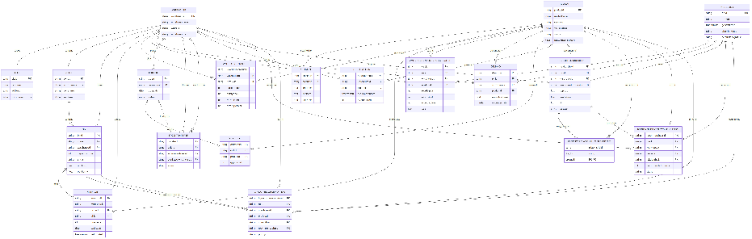

**MedFlow Entity Relationship Diagram Documentation**

**Revision:** Updated 19 Aug 2026

This document is the **ERD diagram specification**. It describes the target diagram: entities, relationships, cardinality, and what changed relative to the live demonstration diagram. It is not a copy of the seed-data specification.

**1. Purpose of the ERD**

The ERD records how MedFlow stores warehouse network, stock, orders, and recommendation outputs.

Planners use three use cases. The diagram must support all three without encoding the network in application identifiers such as WH-CENTRAL.

| Use case | What the diagram must support |
| :---- | :---- |
| **UC1 Product relationship** | Order baskets (orders / orderline) and mined pair rules (productrelationship + antecedent child) |
| **UC2 Replenishment** | On-hand, consumption, warehouse-specific policy, and recommended replenishment from central to subsidiary |
| **UC3 Layout** | Bin coordinates and recommended moves on the **central** floor |
| **UC4 (TBC)** | TBC |

 

**2. Network rules** 

1. One central warehouse (CW) supplies many subsidiary warehouses (SW).

2. Each SW is supplied by exactly one CW. A subsidiary does not belong to, or supply, multiple centrals.

3. The schema permits exactly one warehouse with warehouserole = **CENTRAL**. That row is the sole supplier of every SW.

4. A healthcare site draws stock from an SW. That is downstream consumption. It does not reverse CW-to-SW supply.

5. Stock transfers are always CW to SW. Source and destination must differ.

6. Returns, refunds, and DHL purchase orders to manufacturers are out of scope and do not appear as entities.

On the diagram this is **NOT** a second warehouse table. It is:

warehouse.warehouserole (CENTRAL or SUBSIDIARY)

- a unique constraint of one CENTRAL row  
- site.warehouseid pointing at the serving SW

stocktransfer.sourcewarehouseid (CENTRAL) and destinationwarehouseid (SUBSIDIARY)

**3.   Tables** 

**Network and layout:** WAREHOUSE, SITE, ZONE, BIN

**Product:** PRODUCT, STORAGE

**Operations**: INVENTORY, ORDERS, ORDERLINE, STOCKTRANSFER, CONSUMPTION

**Planning**: DEMAND, WAREHOUSEPRODUCT, WAREHOUSEPRODUCTCALCULATION, MODELRUN

**Use-case outputs**: PRODUCTRELATIONSHIP, PRODUCTRELATIONSHIPANTECEDENT, REPLENISHMENTRECOMMENDATION, LAYOUTRECOMMENDATION

**5. Entity Relationship Diagram**

Figure 1. Target MedFlow ERD after design feedback from Mr Suh (12 Aug 2026). 

**How to read the network on this drawing:**

* *Crow’s foot reading: ||--o{ is one-to-many; ||--o| is one-to-zero-or-on*  
* WAREHOUSE to SITE is one SW to many hospitals.  
* CENTRAL versus SUBSIDIARY is warehouserole, not a second box.  
* Physical movement of stock is STOCKTRANSFER: source = the one CW, destination = one SW.

**6. Relationship catalogue**

| Parent | Child | Cardinality | Business meaning |
| :---- | :---- | :---- | :---- |
| **WAREHOUSE (CENTRAL)** | WAREHOUSE (SUBSIDIARY) | 1 to many, each SW has this CW only | Supply network. Enforced by one CENTRAL row, not a second entity. |
| **WAREHOUSE (SUBSIDIARY)** | SITE | 1 to many | Hospital draws from that SW |
| **WAREHOUSE** | ZONE | 1 to many | Floor areas |
| **ZONE** | BIN | 1 to many | Slots inside a zone |
| **WAREHOUSE** | BIN | 1 to many | Same bin code may exist in more than one warehouse. UNIQUE (warehouseid, binid) |
| **PRODUCT** | STORAGE | 1 to 0..1 | At most one pack specification |
| **WAREHOUSE, PRODUCT, BIN** | INVENTORY | many | Lot grain is warehouse × product × bin × expiry |
| **WAREHOUSE, PRODUCT** | WAREHOUSEPRODUCT | 1 row per pair | Current inventory policy |
| **MODELRUN** | DEMAND, WAREHOUSEPRODUCTCALCULATION, PRODUCTRELATIONSHIP, REPLENISHMENTRECOMMENDATION, LAYOUTRECOMMENDATION | 1 to many | Run lineage |
| **WAREHOUSE** | ORDERS | 1 to many | Subsidiary replenishment orders on CW |
| **ORDERS** | ORDERLINE | 1 to many | Basket for UC1 |
| **ORDERS** | STOCKTRANSFER | 1 to 0..1 | One order, at most one transfer |
| **WAREHOUSE** | STOCKTRANSFER | 1 to many (from and to) | From must be CENTRAL; to must be SUBSIDIARY |
| **PRODUCTRELATIONSHIP** | PRODUCTRELATIONSHIPANTECEDENT | 1 to many | Antecedent SKUs as FKs |
| **PRODUCT** | PRODUCTRELATIONSHIP | 1 to many | Consequent SKU |
| **PRODUCTRELATIONSHIP** | REPLENISHMENTRECOMMENDATION | 0..1 to many | Optional co-pick justification |
| **BIN** | LAYOUTRECOMMENDATION | 1 to many (current and recommended) | Both bins belong to the row’s warehouse |

 

*WAREHOUSEPRODUCT is **not** versioned by runid. Current policy stays on that table. History and UC outputs hang off MODELRUN.*

 **7. Integrity the diagram implies**

These constraints must be true of any schema that implements this ERD.

| Rule | Diagram implication |
| :---- | :---- |
| Exactly one CENTRAL warehouse | Unique partial index on warehouserole = CENTRAL |
| Inventory bin belongs to the same warehouse | Composite FK from inventory to (warehouseid, binid) |
| Layout bins belong to the recommendation warehouse | Trigger or composite FK on current and recommended bins |
| Lot uniqueness | UNIQUE (warehouseid, productid, binid, expirydate) |
| One transfer per order | stocktransfer.orderid UNIQUE |
| Transfer direction | Source CENTRAL, destination SUBSIDIARY, source ≠ destination |
| UC1 itemsets | Child rows for antecedents; consequent is a product FK |

**8. What the diagram omits**

| Omitted | Reason |
| :---- | :---- |
| tenant_id, network_id, country_code | Single local network |
| engine_registry | modelrun.algorithmversion is enough |
| inventory_movement event log | inventory, consumption, and stocktransfer already record movement |
| Alerts, scans, batches, zone permissions | Outside FYP scope |
| Second CENTRAL warehouse | Each SW may have only one CW |
| Returns / upstream DHL POs | Out of scope |

 

