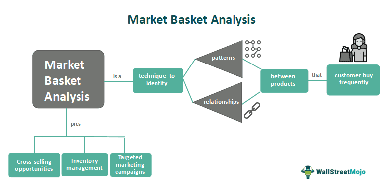
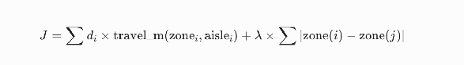
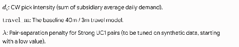
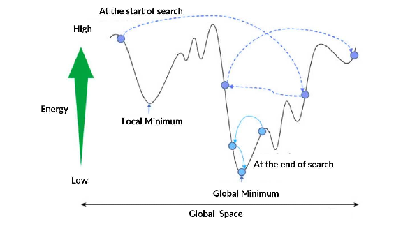
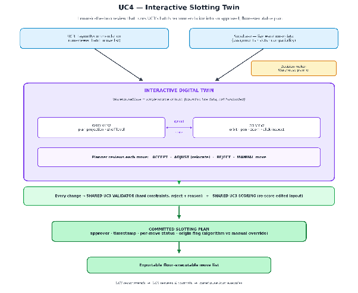

# **MedFlow Technical Approach: Optimisation Algorithms** 

| Last Updated On | 03/9/26, 12:06am  Went deeper on why those methods with research paper backed up. Revision of UC3 & 4  |
| :---- | :---- |

### **Our current team’s direction:**

1. Prioritise core algorithms across UC1 -> UC2 -> UC3   
2. Build useful visualisation alongside those algorithms not basic visual charts / reports  
3. For UC3, start with a grid based slotting visualisation *(same optimisation outcome as 3D).*

### **About the 3D Diagram**

It is a [Three.JS](http://Three.JS) model for UC3, to simulate / show how slotting (*how items are arranged*). Our team is using it mainly for modelling & visual appeal, proposed the grid first (with the vertical shelf in mind), and would add [Three.JS](http://Three.JS) later when the core algorithm and visualisation were completed.

**Optimisation Algorithms** 

| Family | What is it  | Where it Sits |
| ----- | ----- | ----- |
| **Unsupervised Machine Learning  (FP-Growth)** | Discover pairs in order history  | UC1 FP-Growth Association Rules Mining  |
| **Inventory Policy (OR)** | Fixed reorder maths | UC2 ROP / Order-up-to & Central Warehouse Alerts  |
| **Layout Heuristic** | One-pass placement Rules | UC3 Velocity + UC1 Pairs + travel |
| **Metaheuristic Search (Simulated Annealing)** | Try many layouts, keep a better score | UC3 Simulated Annealing  |
| **Human in the Loop Decision** | Let the planner inspect, accept adjust or reject UC3 recommendations without violating warehouse constraint   | UC4 : Interactive Digital Twin |

## **Use Case 1 Association Rule Mining** 

### ***Business Objective & Core Decision***

* Which medical SKUs are frequently ordered together on the same subsidiary order from the central warehouse (WH-CENTRAL)? 

### ***Context***

The central warehouse supplies various medical subsidiaries. By identifying existing purchasing patterns and the product correlations within historical order data, the warehouse can optimise inventory placement (*slotting*),anticipate demand and streamline fulfilment operations. 

### ***Methodology & Metrics Definition*** 

This solution uses Market Basket Analysis using FP-Growth *(Frequent Pattern Growth)* algorithm to discover relationships between items. 

****

***Why FP-Growth not Apriori?***   
According to the foundational research by *Han et al. (2000)* in Mining Frequent Patterns without Candidate Generation, FP-Growth is fundamentally optimised for large scale transaction databases. By using a highly compressed FP-Tree structure, the algorithm completely bypasses the computationally expensive “*candidate generation*” phase that causes memory bottlenecks in other systems.  It requires only 2 sequential scans of the Supabase orderline table, ensuring that our pipeline remains highly performant and memory efficient, even as warehouse SKU counts and order volumes scale over time. 

**Why Association Rules, not a trained classifier?**   
The classic ARM setting (Agrawal Imielinski and Swami, 1993) states ‘the items co-occurring in transactions. There is no prediction target such as ‘will the SKU stock out tomorrow?’ in transactions. There is no prediction target such as ‘will this SKU stock out tomorrow’.  Claiming a neural forecast would over fit synthetic data and would not give planners a pair they can audit. 

The algorithm will evaluates relationships based on ***3 primary statistical metrics:*** 

| Metric | Definition | Business Interpretation  |
| :---- | :---- | :---- |
| **Support**   | The frequency that item A and item B appear in the same basket.  | **Volume**: How common is this specific product combination across all the warehouse orders? |
| **Confidence**  | Given item A, how often item B is also in the basket. | **Predictability:** When a subsidiary orders item A, what is the probability that will also order Item B?  |
| **Lift**  | How much more often A and B appear together than if they were statistically independent.  | **Strength Association:** A lift >1.0 indicates a valid, positive correlation rather than random chance.  (Agrawal et. al, 1993) |

### ***Implementation Pipeline***

The data extraction & modelling pipeline runs as a structured batch process. 

1. **Data Extraction:** Ingest transactional order data by reading the orderline table (orderid, productid) directly from the Supabase relationship database  
2. **Basket construction**: Transform the flat order line data into transactional baskets, where one unique orderid maps to a distinct set of productids.   
3. **Frequent Pattern Mining:** Execute the FP growth algorithm (via the [*mlxtend*](https://rasbt.github.io/mlxtend/) library) and assign the formatted baskets. The minimum support threshold (min_support) is set to 0.02 (2%) to eliminate extreme outliers and computational bloat early in the process. 

4. **Rule generations and Baseline filtering:** Generate association rules from the frequent itemsets. To ensure only actionable and statistically significant rule proceed, apply a strict baseline filter:   
   1. **Support** >= 0.03 (n*ote: adjustment from 0.3 to allow items to flow into 0.04 to 0.08 bands*)  
   2. **Confidence** >= 0.4   
   3. **Lift** >= 1.20   
        
5. **Data ingestion:** write the categorised rule back to the Supabase productrelationship table, tagged specifically for WH-CENTRAL, ensuring the operational system can query the latest insights.

### ***Banding & Classification Strategy***

Not all relationships carry the same operational weight. Once rules pass the baseline filter, they are categorised into three strength bands. These bands dictate how the business reacts to the data. 

| Band | Support  | Confidence | Lift |
| :---- | :---- | :---- | :---- |
| **Strong** | >=0.08 | >= 0.55 | >= 1.50 |
| **Moderate** | >= 0.04 | >= 0.40 | >=1.20 |
| **Weak** | Passes baseline | Passes baseline  | Passes baseline  |

**Justification**

The band thresholds are configurable decision parameters rather than universal association rule standards. They were selected to balance the statistical strength with operational usefulness in warehouse slotting

*  A strong rule requires relatively frequent co-picking (support >0.08), reasonable directional reliability (>0.55) and a positive association of lift (>1.50).  
*  Moderate rules use less restrictive thresholds to capture potential useful secondary relationships.  
*  Rules that pass the baseline filter but do not meet the moderate thresholds are classified as weak and retained for monitoring rather than immediate relocation action. 

As our current evaluation uses synthetic data, these thresholds are severe as initial calibration values. Production deployment would require recalibration using historical DHL picking data and stakeholder validation. 

## **Use Case 2 ROP / Order-Up-To & Central Warehouse Alert** 

### ***Business Objective & Core Decision***

For each subsidiary SKU, is stock too low, how many units need to be transferred from central, can central fulfill the order, and which UC1 companion SKUs should travel in the same order?

### ***Context***

The central warehouse must maintain critical medical supplies across various subsidiaries where demand is often sporadic. To prevent stockouts without over ordering, the warehouse need a transparent, mathematically sound replenishment policy. This ensures reliable service levels, optimises shipping by co packing related items *(identified in UC1),* and gives warehouse managers clear, auditable triggers for every reorder. 

### ***Methodology & Metrics Definition*** 

This solution uses an Operations Research (OR) approach, specifically a deterministic (s,S) Continuous Review Policy to manage inventory replenishment. 

***Why an (s,S) policy?***  
Healthcare replenishment has to be auditable. If a critical SKU stocks out, a planner must be able to replay the quantity such as on hand, reorder point, safety stock, order-up to level. Scarf (1959) establishes that the optimal of (s,S) policies for a standard dynamic inventory problem. Medflow uses the family of rules as a transparent continuous review policy not a black box. *ML models act as  ‘black boxes’ making it difficult for warehouse managers to audit the logic if a critical medical stockout occurs.* 

*A demand forecast neural net or reinforcement learning reorder agent would:*

1. *Require labelled operational demand that this project does not have*   
2. *Hide the quantity behind model weights*  
3. *Not change the fact that transfers are still from central to subsidiary, which is a policy calculation.*

*Hence, the (s,S) policy handles unpredictable demand more reliably than predictive ML, executes instantly without massive computational overhead and provides a mathematically guaranteed service level based on historical consumption.*

| *Metrics* | *Definition* | *Business Interpretation*  |
| :---- | :---- | :---- |
| **ADD** | ***Average Daily demand*** Calculated from trailing 30 day consumption | **Run Rate**: The baseline speed at which a subsidiary consumes this specific SKU. |
| ***s(ROP)*** | ***Reorder Point***  The minimum acceptable inventory threshold  | ***The Alarm:*** if stock drops to or below this line, it immediately triggers a reorder  |
| ***SS*** | ***Safety Stock** from the product master* | ***The Buffer:** used in order up to level and in the Near ROP band*  |
| ***S(OUTL)*** | ***Order-Up-To Level*** The target maximum inventory calculation  | ***The Ceiling:** Exactly how much stock is needed to survive until the next cycle without hoarding excess.*  |

### ***Implementation Pipeline***

The engine runs as a structured batch process to continuously review stock levels against policy threshold. 

* **Consumption calculation**: Obtain actual subsidiary consumption from transaction history. If unavailable, estimate consumption using previous inventory, received stock, current inventory and stock adjustments.  
* **Demand estimation:** Calculate Average Daily Demand using the configurable demandhistorydays, with 30 days as the default.  
* **Policy calculation:** Calculate Z-score, lead-time demand variability, Safety Stock, ROP, EOQ and OUTL for every subsidiary-SKU combination.  
* **Threshold evaluation**: Calculate Inventory Position and compare it with ROP.  
* Quantity determination: When Inventory Position is at or below ROP, calculate **Recommended Quantity** = OUTL − Inventory Position, subject to a minimum of zero.  
* **Central-availability check:** Compare the recommended quantity with central available inventory and determine whether fulfilment is full, partial or unavailable.  
* **UC1 synergy check**: Attach Strong or Moderate companion SKUs for possible joint replenishment without forcing their inclusion.  
* **Data ingestion:** Store the inputs, calculated values, recommendation, status and model-run metadata in Supabase.

### ***Status & Classification Strategy*** 

Not all inventory states require the same urgency. Based on the (s,S)math, SKUs are categorised into 4 actionable status bands that represent the UI alerts and operational response. 

| Status | Rule | UI Action |
| :---- | :---- | :---- |
| **OOS** | On_hand <= 0  | **Urgent Alert**: stockout occurred. Immediate transfer required |
| **Low Stock** | On_hand < Inventory Position<  ROP | **Regular Alert:** reorder threshold breached. Calculate recommended qty.  |
| **Near ROP** | On_hand < Inventory Position <=  ROP + SS  | **Monitor**: Stock is dropping into safety levels, but qty= 0 for now.  |
| **Available** | Above the near ROP band  | **Ok**. Healthy stock level, no action needed.  |

## 

## **Use Case 3 Layout Heuristic & Simulated Annealing** 

### ***Business Objective & Core Decisions*** 

Where should each medical SKU be physically stored within the central warehouse to minimise expected picker travel time, and improve operational efficiency.

The recommended assignment depends on the selected modelling scope that we have:

1. **2.5D Scope:** Assign each SKU to a zone, aisle/bin and shelf. ***Shelf height*** is represented using a level based access time penalty instead of an exact vertical measurement. 

**Why a Heuristic first, Simulated Annealing second?**   
Dedicated / class-based storage,  putting fast movers in convenient locations — is a standard warehouse operations idea (Hausman, Schwarz & Graves, 1976; Gu, Goetschalckx & McGinnis, 2007). MedFlow's Phase 1 heuristic does this in one pass, using velocity class plus UC1 affinity, and produces an explainable move list a planner can read.

The heuristic never revisits an early placement. Simulated Annealing (Kirkpatrick, Gelatt & Vecchi, 1983) is the Phase 2 search: swap two SKUs, keep a better score, and occasionally accept a worse move so the search can escape a poor local layout. SA is not machine learning and does not replace UC1 or UC2.

***Context***  
Picker walking and retrieval are the main contributors to warehouse labour effort. The central warehouse can reduce fulfilment time by:

1. Placing fast-moving SKUs in locations with short access times.  
2. Placing frequently co-ordered SKUs near one another using affinity information generated by UC1.  
3. Accounting for horizontal walking time in both modelling scopes.  
4. Adding shelf-level access effort where retrieval equipment is required.  
5. Respecting operational constraints such as slot capacity, physical fit, storage conditions, weight restrictions and shelf safety.

UC3 terminates at a recommendation. It does not perform, approve, or commit any physical relocation,  those decisions belong to UC4.

***Modelling Scopes*** 

| Scope | Access Time | Optimiser Recommends |
| ----- | ----- | ----- |
| **2.5D** | Horizontal Walking Time + Shelf-Level Access Penalty | SKU → (Zone, Aisle/Bin, Shelf Level) |

### **Shelf-Level Treatment (clarified)**

[To think of a btr wy ltr] 

| Height Band | Access Requirement | Penalty |
| ----- | ----- | ----- |
| MID | Direct waist/chest retrieval | 0s |
| LOW | Bending or crouching | 0s |
| HIGH | Additional reaching | 0s |
| LADDER | Ladder or access equipment required | +20s |

Shelf level functions primarily as a **constraint and assignment dimension** (*physical fit, weight limits, shelf safety*), with a retrieval time penalty applied only where access equipment is required. 

**LOW and HIGH** bands carry no time penalty because ordinary bending and reaching are not reliably separable from base retrieval time without observed DHL picking data. Production deployment would recalibrate all four bands against measured pick times.

This is documented explicitly so that the 2.5D scope's contribution to the cost function is not overstated: the vertical dimension governs *feasibility* for all SKUs and *cost* for ladder-access SKUs.

***Time Calculation*** 

1. **Horizontal Distance (metres)** = (Zone Index × 40) + [(Aisle Number − 1) × 3]

| Zone | Index | Interpretation |
| :---- | ----- | :---- |
| A | 0 | Nearest to packing/depot |
| B | 1 | Near |
| C | 2 | Middle |
| D | 3 | Far |
| E | 4 | Farthest |

***ZONE_METERS (40) and AISLE_METERS (3)*** are configurable schematic constants chosen so every layout is scored on the same yardstick.

 They are not claimed as surveyed DHL aisle lengths. If a site layout is later provided, only the constants change, the method does not.

**Horizontal Walking Time** = (Trip Factor × Horizontal Distance) ÷ Walking Speed  
**Companion Travel Time** = Walkable aisle path distance between two slots ÷ Walking Speed. 

Shelf penalties are already included in individual slot access time and are not added again here.

***Example:***  
*Zone B index = 1*  
*Aisle number = 4*  
***Horizontal Distance** = (1 × 40) + [(4 − 1) × 3] = 40 + 9 = 49 metres*

2. **Convert Distance to Walking Time  (For Reporting and SA Score)** 

***Horizontal Walking Time** = (Trip Factor × Horizontal Distance) ÷ Walking Speed*

| Value | Meaning |
| :---- | :---- |
| Trip factor | 1 for one way travel, 2 for when travel is included  |
| Horizontal Distance | Estimated walking distance in metres |
| Walking Speed | Metres travelled per second |

***Example:*** 

*Using B04, a one way trip and a walking speed of 1 metre per second:*

***Horizontal Walking Time** = (1 × 49 metres) ÷ 1 metre per second = 49 seconds*

*(The same trip factor & walking speed must be used when comparing all layouts)* 

***Time between Co-Picked SKU***

***Companion Travel Time** = Horizontal Path Distance Between the Two Slots ÷ Walking Speed*

***Example:***

*Distance between companion slots = 15 metres*

*Walking speed = 1 metre per second*

*Companion Travel Time = 15 ÷ 1 = 15 seconds*

*This should be a **walkable aisle path**, not a straight line through racks, shelf penalties are already included in individual slot access time and not added here again.* 

### ***Methodology***

1. **Phase 1 : Layout Heuristic (baseline)**  
   This heuristic creates a fast & explainable baseline layout   
   *(starting layout for simulated annealing)*  
1. Filter feasible slots using all hard constraints  
2. Calculate each slot’s access time using 2.5D scope  
3. Rank SKU from highest to lowest velocity  
4. ***Rank feasibility*** slot from fastest to slowest access  
5. Assign high velocity SKU to faster companion SKU  
6. ***Prefer nearby slot*** for strong UC1 companion SKUs  
7. Record only assignments that differ from the current layout 

This is a constructive heuristic. It does not search alternative whole floor layouts. It remains the baseline any SA must beat, and the explainable move list shown to the planner. 

2. **Phase 2: Simulated Annealing (SA)**  
   Improves the heuristic layout by testing alternative arrangement

**States and Neighbours**

| Component | Definition |
| :---- | :---- |
| **State** | Complete mapping of SKUs to warehouse slots |
| **Start** | Heuristic layout |
| **Neighbour**  | Swap 2 compatible SKU into a compatible empty slot  |
| **Best State** | Lowest cost valid layout found  |
| **Stop** | Minimum temperature or maximum iteration reached  |

*****Invalid moves are rejected before scoring.***

**Reference on Simulated Annealing Formula : Objective Function (J)**

|     |
| :---- |

**Objective function:**  
J = Σ (dᵢ × travel_m(zoneᵢ, aisleᵢ)) + λ × Σ |zone(i) − zone(j)|

* **dᵢ** - CW pick intensity (*sum of subsidiary average daily demand*)  
* **travel_m** - baseline 40 m / 3 m travel model  
* **λ -** *pair separation* penalty for Strong UC1 pairs

**Layout Cost Score** = Velocity Cost + Affinity Cost + Optional Relocation Cost + Optional Soft-Constraint Penalty. Lowest score = better layout. The score may include weights and artificial penalties, so business results report time saved separately.

**Acceptance rule  *(Kirkpatrick et, al, 1983)* :** ΔJ = New Score − Current Score. Negative or zero is accepted. Otherwise accepted with probability EXP(ΔJ ÷ Current Temperature).

***Acceptance Probability** = EXP(Delta J ÷ Current Temperature)*

*Python calculates EXP automatically. At **higher temperatures**, **worse moves** are more likely to be accepted. This helps the search escape a local optimum. At a lower temperature, the algorithm becomes more selective.* 

*(Temperature used after the calculation of affinity, temperature determines how willing the algorithm will do that).*

***Cooling***  
Determine how quickly T decreases  
***New Temperature =** Cooling rate x Current Temperature* 

***Example:***   
*Cooling rate  = 0.95*  
*Current temperature = 100*

***New Temperature** = 0.95 × 100 = 95*  
*The cooling rate is tested within a configurable range such as 0.90 to 0.99 ( think of temperature as how willing is the algorithm temporarily accepts worse layout)*   
***// higher -> more willing lower -> less likely*** 

*At the start temperature will be higher as we are exploring*  
*Later, lower temperature = settle as we do not want to keep letting it jump around* 

*TLDR/ of what simulated annealing is about:*

***High temperature → explore different SKU arrangements → gradually cool → increasingly*** 

***favour lower-cost arrangements → finish with the best layout found.***

***Example of an improvement:***  
*Delta J = 900 - 1,000 = -100*

- *A negative / zero means the new layout is equal or better, so it’s accepted.*   
- *A positive result means that the layout is worse.* 

**Cooling:** New Temperature = Cooling Rate × Current Temperature, cooling rate configurable in the range 0.90–0.99.

SA runs with multiple random seeds. The best valid result is retained, and the selected seed and parameters are stored for reproducibility. SA does not guarantee a global optimum within finite runtime, it aims for a high-quality near optimal layout.

***Processing Steps***

1. Start with heuristic layout   
2. Generate a valid neighbouring layout  
3. Calculate its layout cost score  
4. Calculate Delta J.  
5. Accept or reject neighbour  
6. Save the best valid layout found   
7. Stop at the temperature / iteration limit   
8. Return the best layout, not the last layout visited.

SA should run with multiple random seeds. Retain the best valid result and store the selected seed and parameters for reproducibility. Simulated annealing does not guarantee the global optimum within a finite runtime. It aims to find a high quality near optimal layout.

**Constraints**

| Type | Constraint | Treatment |
| :---- | :---- | :---- |
| Hard | Exactly one SKU per slot | Reject invalid move |
| Hard | Zone and slot capacity cannot be exceeded | Reject invalid move |
| Hard | SKU must physically fit the target slot | Compatibility filter |
| Hard | Weight and storage-condition requirements | Compatibility filter |
| Hard | Unavailable or occupied slots cannot be assigned twice | Feasible state generation |
| Hard | Unsafe shelf-level placement is not permitted | Compatibility filter |
| Soft | High-velocity SKUs prefer faster-access locations | Already reflected in velocity cost |
| Soft | Companion SKUs prefer nearby locations | Affinity cost |
| Soft | Limit operational disruption | Optional relocation penalty or cap |

**Architectural requirement:** constraint evaluation is implemented as a **standalone, independently callable validator**, not as logic embedded in the SA neighbour-generation loop. UC4 calls the same validator for planner-initiated moves, guaranteeing that algorithmic and manual placements are judged by one definition of validity.

Likewise, Layout Cost Score is implemented as a **standalone scoring function** that accepts any complete layout, so that a planner-edited layout in UC4 can be scored on the same basis as the current, heuristic and SA layouts.

**Evaluation Metrics**  
Compare the current, heuristic and simulated-annealing layouts using the same analysis period and parameters.

**Time Saved** = Current Access Time − Recommended Access Time  
Example: 69 − 49 = 20 seconds saved per access.

**Improvement (%)** = (Time Saved / Current Access Time) x 100 

Example: ((20 ÷ 69) × 100 ≈ 28.99%

*The recommended slot is approximately **29% faster t**o access. This formula requires current access time to be greater than zero.*

***Demand-Weight Average Access Time*** 

**Demand-Weighted Average Access Time** = Sum of (Pick Frequency × Slot Access Time) for all SKUs   ÷ Total Pick Frequency

**Using SKU A and B from the earlier example:**

= (1,000 + 600) ÷ (100 + 20) = 1,600 ÷ 120 ≈ 13.33 seconds per pick

**Implementation pipeline:** 

1. Extract assignments, slots, demand, UC1 relationships and compatibility data from Supabase.  
2. Select the 2.5 D optimisation scope.  
3. Configure walking speed, trip factor and affinity weight.  
4. Configure shelf penalties if 3D is selected.  
5. Calculate velocity, affinity and slot-access times.  
6. Generate the heuristic layout.  
7. Initialise and run simulated annealing using multiple seeds.  
8. Validate constraints and compare all layouts.  
9. Write changed assignments and run metadata to LayoutRecommendation.  
10. Expose the saved recommendations and comparison metrics for UC4 to consume. 

| Note: UC3 has no separate user facing visualisation requirement. Its deliverables is the structured LayoutRecommendation Output containing current and recommended SKU locations, rationale, scores and run meta data. UC4 reads this output and is responsible for rendering the grid and 3D digital twins, as handling planner actions.  |
| :---- |

## **Use Case 4  Interactive Warehouse Digital Twin & Planner Override**

## **Business Objective** 

Which of the optimiser's recommended moves are accepted, what manual adjustments does the planner impose, and what becomes the committed executable slotting plan?

**Decision-maker:** Warehouse planner, at review and commit time.

**Output:** A validated, human approved slotting plan written to LayoutRecommendation with approval metadata, distinguishing algorithm-generated from manually-overridden assignments, and exportable as a floor-executable move list.

## **Context**

An optimiser cannot encode every operational reality. A SKU may be under recall, a bay may be blocked for maintenance, a supplier may be changing pack size next cycle, or a planner may know that two SKUs must not be co-located for handling reasons not captured in the compatibility attributes.

UC2 argues for a transparent (s,S) policy over black-box ML on the grounds that a planner must be able to replay and audit the logic behind any replenishment decision. UC4 applies the same principle to slotting,  the optimiser's output must be inspectable and overridable by a domain expert without breaking constraint integrity.

Without UC4, UC3's recommendation is an unreviewed batch output. With UC4, it becomes a proposal subject to expert approval,  which is what makes it safe to execute on a live medical warehouse floor.

## **Why an Interactive Twin, not a Static Report?**

A move list of several hundred rows in tabular form cannot be spatially sanity-checked. A planner familiar with the physical warehouse can identify an implausible placement in seconds when it is shown in situ, and effectively never when it is row 147 of a CSV.

The twin is defined by its **data relationship to the warehouse**, not by visual fidelity:

* Warehouse state is a persistent, mutable object bound to live Supabase slot and assignment data, not a hardcoded scene.  
* Every proposed change is validated against the same hard constraints the optimiser uses, via the shared validator defined in UC3.  
* Every accepted layout is written back as an actionable plan.

Geometry is generated procedurally from slot records (***zone, aisle, shelf, dimensions***), so the scene reflects the database rather than a hand-modelled asset. No 3D asset authoring is required, and a layout change in Supabase is reflected without code modification.

## **Methodology & Metrics Definition**

### **State Model**

WarehouseState is the single source of truth for the twin. Rendered geometry reads from state; position is never held in the mesh.

| Method | Behaviour |
| ----- | ----- |
| **loadState()** | Hydrate current SKU→slot assignments from Supabase |
| **validateMove(sku, slot)** | Call the UC3 validator, return valid/invalid plus reason code |
| **moveSKU(sku, slot)** | Apply a validated move, reject with reason if invalid |
| **applyRecommendation(moveId)** | Accept a single UC3-recommended move |
| **rejectRecommendation(moveId, reason)** | Record a rejection without relocating |
| **score()** | Call the UC3 scoring function on the current state |
| **commit()** | Persist approved layout with approval metadata |
| **exportPlan()** | Emit floor-executable move list |

**Decision States per Recommended Move**

| Status | Meaning | Effect on Commit |
| ----- | ----- | ----- |
| **Pending** | Not yet reviewed | Excluded |
| **Accepted** | Planner approves as recommended | Written as algorithm-generated |
| **Adjusted** | Planner accepts relocation but to a different slot | Written as manually-overridden |
| **Rejected** | Planner declines, SKU remains in current slot | Excluded, reason retained |

### 

### 

### **Views**

The twin exposes two synchronised views of the same WarehouseState:

* **Grid view** -  plan projection with shelf level on the vertical axis; carries the same visual language as UC3's delivery surface but is bound to mutable state.  
* **3D view**-  navigable warehouse environment *(orbit, pan, zoom*) with racks, aisles and bins generated procedurally from slot geometry, click-to-inspect SKU detail,  direct manipulation of SKU placement.

Both read from and write to one state object. A change made in either view is reflected in the other.

## **Implementation Pipeline**

1. Hydrate WarehouseState from Supabase current assignments, slots, and compatibility attributes.  
2. Load the active LayoutRecommendation and diff it against current assignments to produce the pending move list.  
3. Generate warehouse geometry procedurally from slot records.  
4. Render the state to grid and 3D views.  
5. **Accept planner input**: inspect, accept, adjust, reject, or manually relocate.  
6. Validate every proposed change through the shared UC3 validator, reject invalid changes with a displayed reason.  
7. Re-score the edited layout using the shared UC3 scoring function, displayed alongside current, heuristic and SA scores.  
8. On commit, write only changed assignments with approver, timestamp, per-move status, and origin flag (*algorithm-generated vs manually-overridden*).  
9. Export the approved plan as a floor-executable move list.

## **Constraints**

| Type | Constraint | Treatment |
| ----- | ----- | ----- |
| **Hard** | All UC3 hard constraints apply identically to manual moves | Shared validator, move rejected with reason code |
| **Hard** | Commit requires at least one accepted or adjusted move | Commit disabled otherwise |
| **Hard** | State must reflect Supabase at load; no hardcoded fixtures | Verified at Definition of Done |
| **Soft** | Planner should be able to reverse any single action | Undo on last move |
| **Soft** | Rejections should carry a reason | Optional free-text field, retained for audit |

## **Evaluation Metrics**

Beyond the UC3 layout metrics, UC4 is assessed on decision quality and integrity:

* **Validation parity** -  for an identical proposed assignment, the manual validator and SA neighbour generation return the same verdict in 100% of test cases.  
* **Score parity** -  a layout scored through the twin and through the batch optimiser returns an identical Layout Cost Score.  
* **Adoption rate** -  proportion of recommended moves accepted, adjusted, or rejected; reported per run as an indicator of recommendation quality.  
* **Committed improvement** -  demand-weighted average access time and time saved for the approved layout, which may differ from the SA-optimal layout where the planner has overridden moves.  
* **Audit completeness** -  every committed assignment carries approver, timestamp, and origin flag.

## **Delivery Surface**

A browser based interface containing the synchronised grid and 3D views, a recommendation review panel with per-move accept / adjust / reject controls, a live score comparison panel, and commit and export actions.

**References:**

**UC1:**  
Agrawal, R., Imielinski, T., & Swami, A. (1993). Mining association rules between sets of items in large databases. *ACM SIGMOD Record, 22*(2), 207–216. [https://doi.org/10.1145/170036.170072](https://doi.org/10.1145/170036.170072)

[Han, J., Pei, J., & Yin, Y. (2000).](https://www.researchgate.net/publication/221214987_Mining_Frequent_Patterns_Without_Candidate_Generation) *Mining frequent patterns without candidate generation*. In Proceedings of the 2000 ACM SIGMOD international conference on Management of data (pp. 1-12). 

**UC2:**  
[Scarf, H. (1959). *The Optimality of (S, s)*](https://www.researchgate.net/publication/243780031_The_Optimality_of_S_s_Policies_in_the_Dynamic_Inventory_Problem) *Policies in the Dynamic Inventory Problem*. In K. J. Arrow, S. Karlin, & P. Suppes (Eds.), *Mathematical Methods in the Social Sciences* (pp. 196-202). Stanford University Press. 

**UC3:**  
Hausman, W. H., Schwarz, L. B., & Graves, S. C. (1976). Optimal storage assignment in automatic warehousing systems. *Management Science, 22*(6), 629–638. [https://doi.org/10.1287/mnsc.22.6.629](https://doi.org/10.1287/mnsc.22.6.629)  
Gu, J., Goetschalckx, M., & McGinnis, L. F. (2007). Research on warehouse operation: A comprehensive review. *European Journal of Operational Research, 177*(1), 1–21. [https://doi.org/10.1016/j.ejor.2006.02.025](https://doi.org/10.1016/j.ejor.2006.02.025)

[Kirkpatrick, Scott & Gelatt, C. & Vecchi, M.. (1983)](https://www.researchgate.net/publication/6026283_Optimization_by_Simulated_Annealing). Optimization by Simulated Annealing. Science. 220. 671-680. 10.1126/science.220.4598.671. 
